## 🔧 Основной проект: Garage710

Full-stack веб-приложение для автостудии в Самарканде: автозвук, EV-сервис, тюнинг, детейлинг.

- **Backend:** [garage710-backend](https://github.com/Javoxir710/garage710-backend): Django 6, DRF, API услуг и категорий, заявки с сайта, уведомления в Telegram, CORS, секреты в `.env`
- **Frontend:** [garage710-frontend](https://github.com/Javoxir710/garage710-frontend): React 19, Vite, react-router, кастомные хуки, lazy loading, CSS Modules, форма с валидацией
- **Демо:** _скоро_ <!-- замени на ссылку, когда задеплоишь -->

## 🛠 Стек

  

## 📌 Другие работы

- **Telegram-бот для оценки б/у iPhone:** aiogram 3 (FSM), Django + DRF, SQLite
- **Instagram710:** клон соцсети, 10 моделей, полный CRUD, социальные функции
- **AWS:** IAM, EC2, VPC, S3, CloudWatch, развёрнутая инфраструктура под учебное задание

## 🎯 Сейчас учу

- Электроника и embedded-системы, направление микроэлектроники и EV
- Английский (IELTS)
- Доделываю Garage710: админ-панель (JWT) и деплой

## 📬 Связь

Telegram: [@V710JM](https://t.me/V710JM)