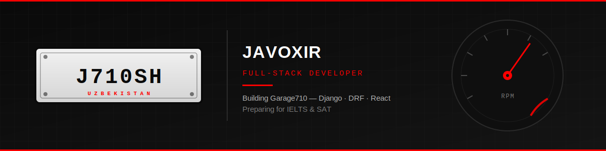

### 🔧 Сейчас работаю над
**Garage710** — full-stack веб-приложение для автостудии в Самарканде

- [Backend (Django + DRF)](ТВОЯ_ССЫЛКА_НА_BACKEND)
- [Frontend (React + Vite)](ТВОЯ_ССЫЛКА_НА_FRONTEND)

### 🛠️ Стек

### 📊 Статистика

### 📫 Связь
Telegram: [@J710SH](https://t.me/J710SH)